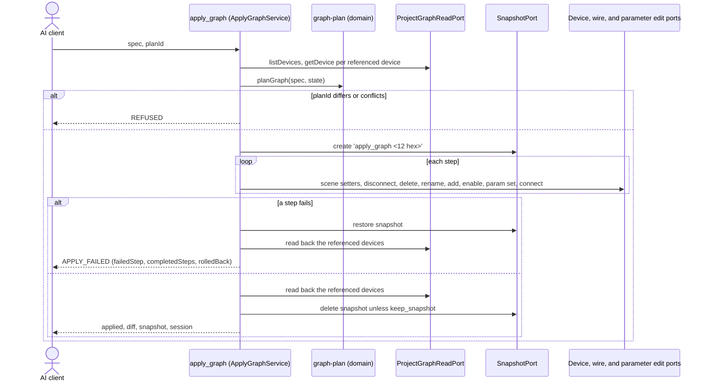

# worldmachine-mcp v3 design: declarative graphs with plan_graph and apply_graph

Date: 2026-10-06
Status: draft, awaiting review
Revision 1 (2026-10-11): facts 78-79 from raw/v3-assumptions.txt; C1 holds, C2 does not (type mapping in fact 79).
Revision 2 (2026-10-11): plan decisions D1, D6, D7, D8.
Revision 3 (2026-10-11): facts 80-81 from raw/v3-rename-probe.txt and raw/v3-rename-types.txt (only a Combiner ignores a rename; `device add` also accepts aliases).
Revision 4 (2026-10-12): section 6 robustness: `diffError` when the result cannot be read after a successful apply, a restore after an internal error, and a process generation in the session check; the plan and diff examples show step ids (D8) and the defined step order.
Revision 5 (2026-10-12): bypassed in device entries (set-bypassed step after set-enabled; restore reverts bypass, raw/bypass-restore.txt).
Revision 6 (2026-10-12): `id` in device entries, so a spec can manage several Combiners; a Combiner entry needs its default name or an `id`; a wire source whose name several devices share is resolved through the candidates' output targets (fact 82), in the plan and in `connect_devices` and `disconnect_devices` (amends v1 section 7). Backlog, lowlands trial items 1 and 2.
Revision 7 (2026-10-15): `rename` in device entries with `id`, a `rename` step after `remove`, and `name` in a `changed` diff entry; fact 100 (`snapshot restore` reverts renames, raw/v7-rename-restore.txt). Amends the Ownership rule of section 4 and the out-of-scope list of section 10.
Revision 8 (2026-10-15): an optional top-level `scene` (name, origin_km, size_km, resolution of the current scene), planned as one `set-scene` step before every device step and shown as `scene` in the apply result; fact 101 (`snapshot restore` reverts all four, raw/v8-scene-restore.txt). Amends section 10.
Revision 9 (2026-10-15): `plan_graph` and `apply_graph` also take a template file with typed parameters instead of an inline spec; see [graph templates design](2026-10-15-worldmachine-mcp-graph-templates-design.md). Amends section 10.
Builds on: [v1 design](2026-10-04-worldmachine-mcp-design.md) (facts 1-41 and 77, the edit tools of section 7, the errors of section 8), [v2a design](2026-10-05-worldmachine-mcp-v2a-design.md) (the build guard), and [v2b design](2026-10-06-worldmachine-mcp-v2b-design.md) (facts 57-61, the snapshot tools)

## 1. Purpose and scope

v3 lets the AI assistant describe a graph instead of editing it one command at a time. One spec format serves two uses:

- generate: build a new graph in an empty or new project from a spec;
- reconcile: bring the devices a spec names in an existing project to the state the spec gives, and leave everything else alone.

Two tools carry it. `plan_graph` reads the project and returns the ordered changes a spec needs, plus a `planId`. `apply_graph` takes the same spec and that `planId`, refuses if the project changed since the plan, applies the changes under a snapshot, rolls back to the snapshot on any failure, and returns a diff of the devices it touched. The split follows the CQRS-lite rule of the project: the query never changes anything, and the command applies only a plan the caller has seen.

The spec owns only the devices it names (section 4). Devices it does not name are never changed, except that their wires to removed devices go with them (fact 34) and the plan says so.

World Machine stays the only program that reads or writes `.tmd` files. v3 adds no World Machine command: every step is one the v1 and v2b edit adapters already send.

## 2. Facts this design rests on

The facts used, facts 78-79 from the v3 capture:

- Device names: `device add <type>` names the device after its type (or a default name such as `Shapes` for `Layout Generator`) without de-duplication (facts 30, 40); names match regardless of case (fact 31); `device rename` accepts a name another device has (fact 32); World Machine keeps 23 characters of a name (facts 33, 77).
- Wires: an input port has at most one source; a connect to an occupied input fails with `Input '<dst>' is already connected. Disconnect first.`; deleting a device removes its wires (fact 34). `wire disconnect` confirms even when no wire existed, so only `wire list` is evidence (fact 26).
- Parameters: `param set` takes World Machine's internal value for a `float`, and `param get` returns display units (setting `0.5` on a parameter shown as `8 km` reads back `4 km`); `int` is strict, `bool` accepts several words, `enum` accepts a 0-based index or a label in any case (facts 18, 35). `action` and `other` parameters cannot be set (fact 36).
- Undo: one step per `param set`, rename, add, delete, or scene setter (facts 28, 37, 39).
- Snapshots: `snapshot restore` reverts the graph, including enabled state and added devices (fact 60); a snapshot is kept in the file only after a save (fact 59); a snapshot name may have 64 characters.
- Fact 78 (C1, raw/v3-assumptions.txt l.90-288): `snapshot restore` reverts parameter values of float, bool, and enum (int was not captured) (float `Amount` 0.25 back to 60.0, bool `maskSoil` false back to true, enum `soilMask` `Linear depth` back to `Presence Mask`), wires on both sides of a device, the enabled state, and removes an added device; a deleted device comes back with its id (#305) and its wires. An enum index 0 on `soilMask` reads back `Linear depth` (l.124-128).
- Fact 79 (C2, raw/v3-assumptions.txt l.311-548): the `Type:` line of `device info`, and the type in the `param list` header, is the name `device add` gives the new device, not the type string it takes: `Layout Generator` gives `Shapes` and `File Output` gives `Height Output`, while `Gradient` and `Advanced Perlin` give themselves. Type comparison maps `Layout Generator` to `Shapes` and `File Output` to `Height Output`; any other type is compared as given, so an unrecorded exception shows as a type conflict and the apply is refused.
- Fact 80 (raw/v3-rename-probe.txt): `device rename #<id> <name>` on a Combiner prints `Renamed '#<id>' to '<name>'` but changes nothing: `device list` and `device info` still show `Combiner`, for every name tried and for a second Combiner. A Gradient renamed in the same session takes the name. An `apply_graph` that adds a Combiner under another name therefore fails at the rename (the device editor's read-back reports it) and rolls back; give a Combiner the name `Combiner`. Across every device type `device add` accepted in raw/v3-rename-types.txt (118 types), the Combiner is the only one that ignores a rename.
- Fact 81 (raw/v3-rename-types.txt): `device add <type>` accepts more than exact type names. Of 2846 candidate names, 205 added a device of one of 118 types: type names in any case (`Thermal weathering`), and also aliases and loose words that pick some other type (`Average` and `Subtract` add a Combiner, `Box` and `Sweep` a Radial Grad, `Byte` and `Terragen` a Height Output, `Water` a Coast Erosion). `apply_graph` therefore checks each added device's listed type (the kind in its `device list` row, or its name when the two are equal) against the spec type through fact 79's mapping, exactly as the type conflict compares; a mismatch fails the add step with `WM_COMMAND_FAILED`, before any rename, and the apply rolls back.
- Fact 82 (revision 6): `wire list <device>` names the devices at both ends of a wire, never their ids. An input shows its source as `<- '<name>' [<output port>]` (raw/water-sea-erosion.txt l.481: `[1] Terrain <- 'Combiner' [1]`); an output shows each target as `-> '<name>' [<input port>]`, one per line, further targets on continuation lines (raw/default-updated.txt l.99-100, raw/v5-read-formats.txt l.45, raw/water-sea-erosion.txt l.164-166). When several devices share the source's name, the input alone does not say which one feeds it; the candidate whose output port lists the destination's name and input port does. A Combiner's own output targets use the same format: confirmed by the revision 6 live test on 2026-10-12 (test/live/graphs.live.test.ts, 5/5 passed).
- Fact 100 (revision 7, raw/v7-rename-restore.txt): `snapshot restore` reverts a rename made after the snapshot, both of a device added before it (l.87, l.120: `Renamed Grad` back to `Gradient`) and of a device of the default project (l.70, l.103: `Renamed Orig` back to `Height Output`). A renamed device's `device list` row shows its type as the kind (`#1     Renamed Orig             (Height Output)`), as fact 81 describes. The wires are unchanged by the renames and by the restore (l.90-96, l.123-129).
- Fact 101 (revision 8, raw/v8-scene-restore.txt): `snapshot restore` reverts the scene name, origin, size, and resolution set after the snapshot (l.17-48: `Probe Scene`, (1.50, -2.25), 6.00 x 5.00, 513 back to `Main Extents`, (4.00, 4.00), 12.00 x 12.00, 2049); fact 69 covered the resolution only. A value with a third decimal is shown rounded to two in the confirmation and in `scene show` (l.53-71: `scene size 6.125 6.005` shows `6.13 x 6.01`, `scene origin 0.333 0.335` shows `0.33, 0.34`); what World Machine keeps cannot be read back.

### Assumptions settled by capture

- C1 (does `snapshot restore` revert parameter values, wires, and deleted devices): holds, fact 78. Rollback restores the snapshot (section 6).
- C2 (is `device info`'s `Type:` the `device add` type string): does not hold, fact 79. Type comparison uses the mapping fact 79 records.

## 3. MCP tools

| Tool | Kind | Annotations | Behaviour |
|---|---|---|---|
| `plan_graph` | query | read-only | `{ spec }`. Validates the spec (section 4), reads the project (section 5), and returns `{ planId, conflicts, steps, unchanged, session }`. Sends only read commands. A plan with conflicts is still returned, so the caller can show them; `apply_graph` refuses it. |
| `apply_graph` | command | not read-only, destructive, not idempotent | `{ spec, plan_id, keep_snapshot? }`. Validates and plans again inside one exclusive section, refuses when the new `planId` differs from the given one or the plan has conflicts, then applies the steps under a snapshot (section 6). Returns `{ applied, snapshot, diff, session }`. Marks the session unsaved unless the plan is empty. |

The `apply_graph` description says: plan first and show the plan to the user; a float or enum parameter is always set because its current value cannot be compared; on failure the project is restored to the snapshot taken before the first step; `undo` does not revert an apply in one step, the snapshot does.

## 4. The graph spec

```json
{
  "version": 1,
  "devices": [
    { "name": "Shape", "type": "Layout Generator" },
    {
      "name": "Base",
      "type": "Advanced Perlin",
      "enabled": true,
      "parameters": { "octaves": 8, "scale": 0.4 },
      "inputs": { "1": "Shape.1", "2": null }
    }
  ],
  "remove": ["Old Noise"]
}
```

- `version` is required and must be `1`.
- `devices[].name` is the identity of a managed device when the entry has no `id`. `devices[].type` is the exact World Machine type.
- `devices[].id` (revision 6) is optional, a positive integer: the id of an existing device the entry manages. With `id`, `name` is a label local to the spec: inputs refer to the device by it, and it is never sent to World Machine and never compared with the device's listed name. An entry with `id` never adds a device. The id comes from `list_devices`, `add_device`, or a previous apply's diff, and the client writes it into the spec:

  ```json
  { "name": "hills mix", "id": 536, "type": "Combiner", "inputs": { "1": "Base", "2": "Hills" } }
  ```
- `devices[].rename` (revision 7) is an optional boolean, `false` when omitted, and is allowed only with `id`. With `rename: true`, the device's listed name is made equal to the entry's `name`: the label becomes the device's name in World Machine. Without it, a label is still never sent or compared, so specs written before revision 7 plan exactly as before:

  ```json
  { "name": "Ridges", "id": 12, "type": "Advanced Perlin", "rename": true }
  ```
- `enabled`, `bypassed`, `parameters`, and `inputs` are optional. What a device entry leaves out is left as it is. `bypassed` is a boolean that is set, not toggled (`set_device_bypassed` reads the state first); `device info` reports it even for a disabled device (fact 29).
- `inputs` maps an input port number (as a string key) to a source, `"<device>"` or `"<device>.<outputPort>"` (port 1 when omitted), or to `null` for no wire. A source is a managed device's name or label, any device's name, or `#<id>`, looked up in that order. An input port the entry does not list is left alone.
- `remove` lists device names (or `#<id>`) to delete. Deleting is never implied by absence.
- `scene` (revision 8) is optional: the current scene's settings, with the fields and rules of `configure_scene` (v1 section 7): `name` (a non-empty string), `origin_km` (`{ x, y }`), `size_km` (`{ width, height }`, positive), and `resolution` (a positive whole number), each optional. A spec without `scene` plans exactly as before and reads no scene. The spec never switches, adds, or removes scenes:

  ```json
  { "version": 1, "scene": { "size_km": { "width": 8, "height": 8 }, "resolution": 1025 }, "devices": [] }
  ```

### Validation (before any command)

Refused with `REFUSED`, nothing sent:

- `version` other than 1; more than 200 entries in `devices` plus `remove`;
- revision 8: a `scene` with no field; an empty scene name; a size value that is not positive; a resolution that is not a positive whole number; an origin or size value that is not a plain decimal number or has more than two decimals, because World Machine shows two (fact 101) and a second plan could never match it;
- a name that is empty, longer than 23 characters, starts or ends with a space, or has the form `#<n>`;
- two `devices` entries whose names are equal regardless of case; a name in both `devices` and `remove`;
- an `id` that is not a positive integer; two `devices` entries with the same `id`; an `id` whose `#<id>` is in `remove` (revision 6). Labels follow the name rules above, so a label is always a name World Machine keeps whole;
- `rename` on an entry without `id` (revision 7): such an entry's name is its identity, so there is nothing to rename it from; the reason says to give the device's `id`;
- a port number that is not a positive integer; a source string that does not parse;
- a name that ends in `[disabled]` or `[bypassed]`, or that has two spaces followed by parenthesised text (as `add_device` refuses); a `remove` entry listed twice;
- a `remove` entry that is not a `#<id>` reference and breaks a device name rule (longer than 23 characters, starts or ends with whitespace, ends in a marker or a kind suffix, or has the form `#<n>`), because World Machine keeps 23 characters of a name and `device list` trims names, so such an entry never matches and would be reported as already absent while the device stays;
- the `exportAlways` parameter, and a number written in exponent form (v1 section 9).

Validation refuses only what needs no device type. A value the listed parameter type refuses (an enum label, a decimal for an int, a `filename` parameter, or an action or other parameter that cannot be set) is a conflict for an existing device (section 5), and fails during apply, with rollback, for a device the plan adds.

### Ownership

A device is managed when an entry gives its id, or, for an entry without `id`, when its name, compared regardless of case, appears in `devices`. Unmanaged devices keep their parameters, enabled state, and input wires. A managed device's input may come from an unmanaged device, and the spec may reference it by `#<id>` when its name is not unique.

Renaming (revision 7, replacing the rule that the spec never renames): for an entry without `id` a name is the identity, so a new name is a new device. An entry with `id` is renamed only when it has `rename: true`, and then to its `name`. A rename is never inferred from a label that differs from the listed name, because labels are how a spec tells several Combiners apart (revision 6), and a Combiner ignores a rename (fact 80). `rename_device` stays the tool for a single rename.

Revision 6: an entry without `id` whose type ignores a rename (fact 80: Combiner, also when the spec gives an alias such as `Average`, fact 81) and whose name is not exactly that type's default name (compared with case, since the add renames to any other spelling and World Machine ignores that rename too) can match no device and cannot be added under its name, so each apply of the spec would add another. It is a conflict when no device has its name; the reason says to add the device with `add_device` and give its id in the spec, and, when the spec type is an alias, to give the type as `Combiner` (an alias type fails the type check of fact 81). An entry named `Combiner` keeps working as before, as long as one device has that name.

## 5. Planning

`planGraph(spec, state)` is a pure domain function (`src/domain/graph-plan.ts`). The services read `state` first:

- revision 8: `scene show` once, before the device reads, when the spec has `scene`;
- `listDevices()` once;
- `getDevice(#<id>)` for every existing device an entry's `id`, a managed name, a `remove` entry, or an input source resolves to;
- revision 6: then `getDevice(#<id>)` for every not yet read device that shares its listed name with the current source of an input read in the step before, so the source can be resolved (below). No extra read happens when every such name is unique.

### Resolving a current wire source (revision 6)

`resolveWireSource` (`src/domain/wire-source.ts`, pure) takes the destination's listed name, one of its inputs, the device list, and the output ports of devices read so far. The candidates are the listed devices whose name is the input's source name (by listed name, fact 33). One candidate is the source. With several, the source is the one candidate whose output port (the input's source port) lists a target with the destination's name and the input's port (fact 82). The result is `none` (no wire), `found` (id and port), `ambiguous` (two or more candidates qualify; their ids), or `unknown` (none qualifies). The planner and the wire editor use the same function.

`ambiguous` remains possible when two same-named devices each feed an input with the same port number on two devices that also share a name, for example two Combiners each feeding input 1 of another Combiner. A layered graph such as base and hills into one Combiner, that Combiner and masked mountains into a second, and the second into Erosion, resolves fully.

### Conflicts

A conflict makes `apply_graph` refuse. Each names the spec entry and the reason:

- revision 8: the scene is locked (fact 38) and a `scene` field differs from it; the entry is `scene` and the reason says to unlock the scene in World Machine. A locked scene that matches the spec is no conflict;
- a managed name, or a `remove` name, matches more than one device;
- an entry's `id` matches no listed device (revision 6; such an entry never adds);
- an entry without `id` whose type ignores a rename, named other than its default name, that matches no device (revision 6, section 4 Ownership);
- a managed device exists with a type other than the spec's (the comparison goes through fact 79's mapping);
- an input source does not resolve, matches more than one device, or is a device in `remove`;
- an input port or output port number the existing device does not have;
- a parameter name the existing device does not list, or a parameter of type `action` or `other`;
- for an existing device, a parameter value its listed type refuses (the same rule as the parameter editor);
- a current input source that `resolveWireSource` reports as `ambiguous` or `unknown`; the reason names the candidate ids (revision 6; before it, any shared source name was a conflict).
- revision 7, an entry with `rename: true` whose `name` is not exactly (with case) the device's listed name, when the device's type ignores a rename (fact 80: a Combiner); the reason says World Machine ignores renames of that type;
- revision 7, an entry with `rename: true` whose `name`, compared regardless of case, is the listed name of another device that the apply keeps (a device in `remove` does not count). World Machine would accept it (fact 32), but the two devices would then share a name, and every later lookup by that name would be ambiguous. Two entries that swap names are therefore refused too; the client renames through a temporary name in two applies;
- revision 7, an input source in the spec that resolves, through the "any device's name" lookup of section 4, to a device that the same apply renames, so the source names the old listed name. It would resolve this time and fail on the next plan, so the reason says to use the entry's label.

A removed device's `wiresRemoved` (step 2) is keyed by the ids `resolveWireSource` finds, so two wires to devices that share a name are both listed (revision 6).

For a device the plan adds, ports, parameter names, and the types of parameters are only known after the add. A wrong one fails during apply, which rolls back.

### Steps

Steps run in this order, and within each group in spec order:

1. `set-scene` (revision 8): one step when a `scene` field differs from `scene show`, `{ "op": "set-scene", "changes": { "<field>": { "from": <current>, "to": <spec> } } }` with only the differing fields (`name`, `originKm`, `sizeKm`, `resolution`). `name` and `resolution` are compared exactly, origin and size per value at two decimals. It runs first, since it depends on no device. It is sent through `SceneEditPort.configureScene` with the changed fields, which sends each setter, checks its confirmation (fact 27), and returns `scene show`; a returned value that does not match the step's `to` under the same comparison fails the step. When no field differs, `scene` is listed in `unchanged`;
2. `disconnect`: an input whose spec source differs from its current source, or whose spec value is `null` while a wire exists;
3. `remove`: each `remove` entry that exists, with the wires it takes along (`wiresRemoved`); an entry that matches nothing is listed in `unchanged` as `already absent`;
4. `rename` (revision 7): each entry with `rename: true` whose `name` differs from the listed name, compared with case, so a change of case alone is a rename. It runs after `remove`, because a device may take the name of a device the same apply removes, and before `add`, which cannot collide with it because two entries never share a name (section 4). The step is `{ "op": "rename", "device": "<label>", "id": <id>, "from": "<listed name>", "to": "<label>" }` and is sent as `device rename #<id> <name>` through `DeviceEditPort.renameDevice`, whose read-back of the `device list` row fails the step when the new name does not show. The predicted wiring of the unidentifiable-wires and wire-loops designs applies the step too: from it on, the device's predicted listed name is its label, and the wire texts that name it carry the new name (the output target lines of the sources that feed it, and the inputs of managed devices it feeds, where the current state identifies the wire);
5. `add`: each managed device that does not exist, renamed to the spec name when its default name differs;
6. `set-enabled`: when `enabled` differs from the current state;
7. `set-bypassed`: when `bypassed` differs from the current bypass state, which is compared exactly (a second plan of the same spec plans nothing for it). A device the plan adds starts not bypassed, so it gets this step only when `bypassed` is `true`, as `set-enabled` is planned for an added device only when `enabled` is `false`. `snapshot restore` reverts bypass (raw/bypass-restore.txt), so a failed apply restores it;
8. `set-parameter`: per parameter, when it differs or cannot be compared (below);
9. `connect`: each input whose spec source is not its current source.

Disconnecting before connecting is required: an occupied input refuses a connect (fact 34).

Parameter comparison with the current value from `param list`:

| Type | Compared as | Set when |
|---|---|---|
| `int` | integers | different |
| `bool` | `true/1/yes/on` against `false/0/no/off`, any case | different |
| `enum`, `float`, any other type | not compared | always, with `comparable: false` |

An enum is never compared: World Machine reports a label and the spec gives an index. Labels in a spec are refused by validation (section 4).

A spec applied twice in a row therefore plans only its `comparable: false` steps the second time; a renamed device's listed name equals its label after the first apply, so the second plan has no `rename` step.

### Plan output

```json
{
  "planId": "3f9a…",
  "conflicts": [],
  "steps": [
    { "op": "disconnect", "device": "Eroded", "id": 20, "port": 1, "from": "Old.1",
      "source": { "device": "Old", "id": 12, "port": 1 } },
    { "op": "add", "device": "Base", "type": "Advanced Perlin" },
    { "op": "set-parameter", "device": "Base", "name": "scale", "to": "0.4", "comparable": false },
    { "op": "set-parameter", "device": "Eroded", "id": 20, "name": "steps", "from": "4", "to": "6", "comparable": true },
    { "op": "connect", "device": "Eroded", "id": 20, "port": 1, "from": "Base.1",
      "source": { "device": "Base", "port": 1 } }
  ],
  "unchanged": ["Shape"],
  "session": { "state": "ready", "dirty": false }
}
```

`planId` is the SHA-256, in hex, of a canonical JSON document holding the open project path, the validated spec, and every part of `state` the plan read (ids, names, types, enabled states, parameter rows, input sources, and, revision 8, the scene when the spec has `scene`). Any change to those between `plan_graph` and `apply_graph` changes it.

## 6. Applying



Everything runs inside one `exclusive()` section, so no other tool call interleaves.

Preconditions, checked before the snapshot: no build is running (the v2a build guard, `REFUSED`), and no snapshot named `apply_graph <first 12 hex of planId>` exists (`REFUSED`, naming it). Unsaved changes are allowed: the snapshot holds the graph in memory.

An empty plan (no steps) applies nothing, takes no snapshot, and returns `applied: 0`.

### Failure

When a step fails with a `WorldMachineError` (`WM_COMMAND_FAILED`, `UNEXPECTED_OUTPUT`, or `REFUSED` from an edit port, for example an unknown parameter on an added device):

1. `snapshot restore` of the apply snapshot;
2. a read-back of the devices the plan referenced, compared with `state` from before the first step;
3. `APPLY_FAILED` with `failedStep` (index, step, and the step's own `code`, `message`, and `worldMachineMessage`), `completedSteps`, `rolledBack`, and `snapshot` (the name; kept for inspection).

`rolledBack` is `true` only when the restore succeeded and the read-back matches. Otherwise it is `false` and the message tells the user to restore the named snapshot in the World Machine window or with `restore_snapshot`.

On `TIMEOUT` or `CRASHED` no restore is sent. `rolledBack` is `false`. After a timeout or a crash the snapshot is gone too, since it lived only in memory (fact 59), and the message says so.

The check that World Machine is still the same session compares a process generation (a counter that increases each time a World Machine process becomes current) as well as state and binding, so a restart anywhere during an apply, even a silent one back to the default project, counts as World Machine lost. The error code is `CRASHED` for a restart caught between steps or around the diff read, while a step that fails after a silent restart keeps its own code in `failedStep.code` and reports the loss in its message with `rolledBack: false`.

Added 2026-10-12: a step that throws something other than a `WorldMachineError` (a bug) also triggers the restore, when World Machine is still the same session. The error is then a plain internal error whose message names the step, the snapshot, the restore outcome, and the original error; the client still sees only the generic internal-error text, and the stack goes to the server log.

### Diff

After success, the referenced devices are read back:

```json
{
  "applied": 5,
  "snapshot": null,
  "diff": [
    { "device": "Base", "change": "added",
      "after": { "id": 536, "type": "Advanced Perlin", "enabled": true, "bypassed": false,
                 "parameters": { "scale": "4 km" }, "inputs": { "1": "Shape.1" } } },
    { "device": "Old Noise", "change": "removed", "before": { "id": 12, "type": "Perlin Noise" } },
    { "device": "Eroded", "change": "changed", "id": 20,
      "bypassed": { "before": false, "after": true },
      "parameters": { "steps": { "before": "4", "after": "6" } },
      "inputs": { "1": { "before": "Old.1", "after": "Base.1" } } }
  ],
  "session": { "dirty": true }
}
```

Revision 8: the result has an optional `scene`, `{ "<field>": { "before": <value>, "after": <value> } }`, with each field whose value in the scene the `set-scene` step returned differs from the state's scene; it is left out when the plan had no `set-scene` step or nothing changed. A failed apply needs no scene work of its own: the restore reverts the scene (fact 101), and the read-back after a restore compares the scene too when the spec has `scene`.

A `changed` entry carries `enabled` and `bypassed` as `{ before, after }` only when the read-back value changed, and (revision 7) `name` as `{ before, after }` when the listed name changed; a device whose only change is a rename is still listed. An input whose source the steps change between two devices whose read-back names are equal (fact 82: `wire list` names devices), for example a removed device and a device the same apply renames to its name, shows both sides by id in the spec's source form, `{ "before": "#13.1", "after": "#12.1" }` (revision 7 follow-up, 2026-10-15). Parameters appear in the diff only when their read-back value changed; a float set to the value it already had does not appear. `snapshot` is the kept snapshot's name when `keep_snapshot` is true, otherwise `null`.

Added 2026-10-12: if the read-back fails with a `WorldMachineError` while World Machine is still the same healthy session, the apply still succeeded. The result then has `diff: []`, `diffError` (the error's message, without World Machine text), and the snapshot kept. On `TIMEOUT`, `CRASHED`, or a changed session, the call throws an error with the same code saying that all steps were applied but the result could not be read, and that the unsaved changes and snapshot are gone.

## 7. Ports and files

- `src/application/port/in/query/plan-graph-query.ts` and `src/application/port/in/command/apply-graph-command.ts`, one port each.
- `src/application/service/plan-graph-service.ts` and `apply-graph-service.ts`; a shared `read-graph-state.ts` helper reads `state` through `ProjectGraphReadPort`.
- The zod schema lives in `src/adapter/in/mcp/schemas.ts` and admits structure only.
- `src/domain/graph-spec.ts` (types and `validateGraphSpec`, which refuses with `REFUSED`), `graph-plan.ts` (`planGraph`, `planId`), and `graph-diff.ts`.
- Revision 6: `src/domain/wire-source.ts` (`resolveWireSource`), used by `graph-plan.ts` and by the wire editor adapter (`world-machine-wire-editor.ts`). `planId` already covers every detail read, including the second-phase reads.
- Revision 6, amending v1 section 7 (`connect_devices`, `disconnect_devices`, and the `REFUSED` row): when the destination's input shows the given source's own listed name and several devices share it, the wire editor runs `wire list #<id>` for each of them before any change and resolves the source. `found` and the given source: `connect` leaves the wire (`created: false`) and `disconnect` removes it. `found` and another device: `connect` sends (World Machine refuses the occupied input) and `disconnect` returns `removed: false` with nothing sent. `ambiguous` or `unknown`: `REFUSED`, naming the candidate ids, nothing sent. The checks after a change stay name-based, since an input holds one wire. An input that shows another name, or no wire, is not wired from the given source, exactly as before revision 6, whether or not that other name is shared.
- Outbound ports unchanged: `ProjectGraphReadPort`, `DeviceEditPort`, `WireEditPort`, `ParameterEditPort`, `SnapshotPort`.
- Revision 8: `ApplyGraphService` takes the existing `SceneEditPort` (the port `configure_scene` uses), and `readGraphState` reads the scene through the graph read port's `scene show` reader when the spec has `scene`. The schema gets `scene`, the plan step schema `set-scene`, and the apply view `scene`; the `plan_graph` and `apply_graph` descriptions show `scene?` in the spec shape. The fake World Machine's snapshot holds the scene (fact 101).
- Revision 7: no new port or World Machine command. The plan's `rename` step uses `DeviceEditPort.renameDevice`, which `rename_device` already uses. Rollback needs no extra work, since a restore reverts renames (fact 100). The schema's description of `id` ("such an entry is never added or renamed") changes to say that it is renamed only with `rename: true`, and `rename` gets its own description.
- `APPLY_FAILED` is added to the error codes (v1 section 8): "a step of `apply_graph` failed; effect: the apply snapshot was restored when `rolledBack` is true".

## 8. Testing

- Domain, pure: every step kind and every conflict kind; the step order; names compared regardless of case; a 23-character name; `planId` stable for the same input and different when any read field changes; a second plan after a simulated apply holds only `comparable: false` steps; parameter comparison per type.
- Validation: a table of refused specs, one row per rule in section 4.
- Services against the fake World Machine: plan, apply, plan again; a stale `planId` refused; a failure at step k (a new fake knob that fails the n-th `param set`) restored with `rolledBack: true`; a failing restore giving `rolledBack: false`; a running build refused; an existing apply snapshot name refused; an empty plan takes no snapshot. The fake's `snapshot restore` restores parameters and wires as C1 shows.
- Captures: C1 and C2, settled as facts 78-79.
- Live (`WM_LIVE=1`, after the user approves the run), at resolution 257 in a temporary folder: apply a three-device spec to a new project; plan again and see only float steps; apply a spec that rewires a device and removes one; apply a spec whose added device has an unknown parameter and see the rollback.
- Revision 6: `resolveWireSource` for one candidate, one of several qualifying, chained Combiners that resolve, `ambiguous`, `unknown`, a name cut at 23 characters, and a port mismatch at either end; validation rows for `id`; planning rows for an entry with `id` (found, missing, type conflict, a label that differs from the listed name plans no rename), the Combiner rule (including the `Average` alias), the layered graph of section 5 with no conflicts, and `wiresRemoved` with two same-named targets; the second-phase reads (only unread candidates, none when names are unique); the wire editor's outcomes per case. The fake World Machine models a Combiner that ignores a rename and lists output targets of same-named devices before these tests are written. Through the fake: apply the layered graph, plan again, and see no steps other than `comparable: false` ones. Live, after the user approves the run: add two Combiners, apply a spec that binds them by `id`, plan again for no comparable steps, and disconnect a wire from one Combiner while the other exists; this also checks fact 82's assumption about a Combiner's output targets.
- Revision 7: validation rows for `rename` without `id`, and `rename: false` with `id` (accepted, no step). Planning rows: a rename planned; a case-only rename; equal names plan nothing; the Combiner conflict, also with the `Average` alias, and a Combiner whose label is exactly its listed name (no step, no conflict); the name clash with a kept device, with another renamed entry (a swap), and no clash with a device in `remove`; a source that names the old listed name of a renamed device; the step order with `rename` between `remove` and `add`; a `connect` from a device renamed in the same apply. The fake World Machine's `snapshot restore` restores names before these tests are written. Through the fake: apply a rename and plan again for no `rename` step; a later step fails and the rollback restores the name (`rolledBack: true`); the diff's `name` entry. Live, after the user approves the run: in `graphs.live.test.ts`, apply a spec that renames an existing device by `id` and plan again for no `rename` step.

- Revision 8: validation rows (an empty `scene`, three decimals in origin and in size, a size of 0, a resolution of 1.5 and of 0, an empty name); planning rows (each field differing alone, all equal so `unchanged` holds `scene`, a two-decimal value matched, a locked scene with and without a difference, `set-scene` first, the `planId` changing with the scene and unchanged for a spec without `scene`, no `scene show` sent for a spec without `scene`). Through the fake: apply a resolution and size change, plan again for no `set-scene`; a later step fails and the scene is restored (`rolledBack: true`); the apply view's `scene`. Live, after the user approves the run: apply `scene: { resolution: 513, size_km: { width: 6, height: 6 } }` (a blank project is already 8 x 8 km at 1024) to a new project and plan again for no `set-scene` step.

## 9. Documentation

The README gets a section on `plan_graph` and `apply_graph` with the spec example of section 4, the ownership rule, the float rule, and rollback.

Revision 8: that section gets a `scene` example, the two-decimal rule, and the locked-scene conflict.

Revision 7: that section gets a `rename: true` example and the rule that a label is never sent to World Machine without it.

## 10. Out of scope

Listing or saving templates (revision 9 reads them only), other scenes than the current one (switching, adding, or removing scenes), groups, layout and device positions (`organize_devices` exists), spec versions other than 1, and exports or builds as part of an apply.
