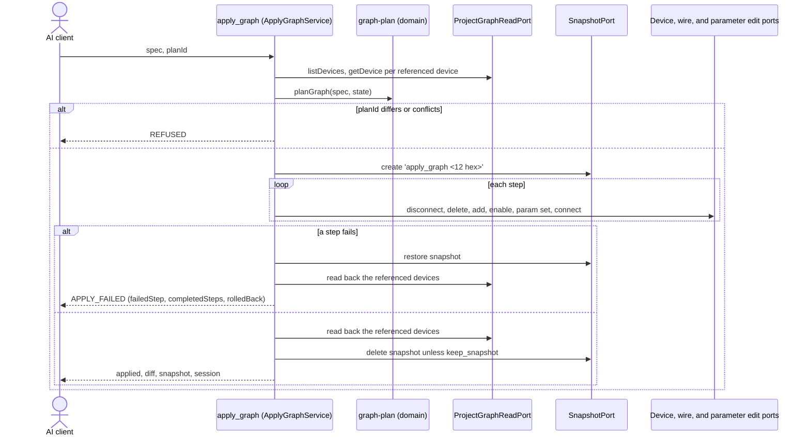

# worldmachine-mcp v3 design: declarative graphs with plan_graph and apply_graph

Date: 2026-10-06
Status: draft, awaiting review
Revision 1 (2026-10-11): facts 78-79 from raw/v3-assumptions.txt; C1 holds, C2 does not (type mapping in fact 79).
Revision 2 (2026-10-11): plan decisions D1, D6, D7, D8
Builds on: [v1 design](2026-10-04-worldmachine-mcp-design.md) (facts 1-41 and 77, the edit tools of section 7, the errors of section 8), [v2a design](2026-10-05-worldmachine-mcp-v2a-design.md) (the build guard), and [v2b design](2026-10-06-worldmachine-mcp-v2b-design.md) (facts 57-61, the snapshot tools)

## 1. Purpose and scope

v3 lets the AI assistant describe a graph instead of editing it one command at a time. One spec format serves two uses:

- generate: build a new graph in an empty or new project from a spec;
- reconcile: bring the devices a spec names in an existing project to the state the spec gives, and leave everything else alone.

Two tools carry it. `plan_graph` reads the project and returns the ordered changes a spec needs, plus a `planId`. `apply_graph` takes the same spec and that `planId`, refuses if the project changed since the plan, applies the changes under a snapshot, rolls back to the snapshot on any failure, and returns a diff of the devices it touched. The split follows the CQRS-lite rule of the project: the query never changes anything, and the command applies only a plan the caller has seen.

The spec owns only the devices it names (section 4). Devices it does not name are never changed, except that their wires to removed devices go with them (fact 34) and the plan says so.

World Machine stays the only program that reads or writes `.tmd` files. v3 adds no World Machine command: every step is one the v1 and v2b edit adapters already send.

## 2. Facts this design rests on

The facts used, facts 78-79 from the v3 capture:

- Device names: `device add <type>` names the device after its type (or a default name such as `Shapes` for `Layout Generator`) without de-duplication (facts 30, 40); names match regardless of case (fact 31); `device rename` accepts a name another device has (fact 32); World Machine keeps 23 characters of a name (facts 33, 77).
- Wires: an input port has at most one source; a connect to an occupied input fails with `Input '<dst>' is already connected. Disconnect first.`; deleting a device removes its wires (fact 34). `wire disconnect` confirms even when no wire existed, so only `wire list` is evidence (fact 26).
- Parameters: `param set` takes World Machine's internal value for a `float`, and `param get` returns display units (setting `0.5` on a parameter shown as `8 km` reads back `4 km`); `int` is strict, `bool` accepts several words, `enum` accepts a 0-based index or a label in any case (facts 18, 35). `action` and `other` parameters cannot be set (fact 36).
- Undo: one step per `param set`, rename, add, delete, or scene setter (facts 28, 37, 39).
- Snapshots: `snapshot restore` reverts the graph, including enabled state and added devices (fact 60); a snapshot is kept in the file only after a save (fact 59); a snapshot name may have 64 characters.
- Fact 78 (C1, raw/v3-assumptions.txt l.90-288): `snapshot restore` reverts parameter values of float, bool, and enum (int was not captured) (float `Amount` 0.25 back to 60.0, bool `maskSoil` false back to true, enum `soilMask` `Linear depth` back to `Presence Mask`), wires on both sides of a device, the enabled state, and removes an added device; a deleted device comes back with its id (#305) and its wires. An enum index 0 on `soilMask` reads back `Linear depth` (l.124-128).
- Fact 79 (C2, raw/v3-assumptions.txt l.311-548): the `Type:` line of `device info`, and the type in the `param list` header, is the name `device add` gives the new device, not the type string it takes: `Layout Generator` gives `Shapes` and `File Output` gives `Height Output`, while `Gradient` and `Advanced Perlin` give themselves. Type comparison maps `Layout Generator` to `Shapes` and `File Output` to `Height Output`; any other type is compared as given, so an unrecorded exception shows as a type conflict and the apply is refused.

### Assumptions settled by capture

- C1 (does `snapshot restore` revert parameter values, wires, and deleted devices): holds, fact 78. Rollback restores the snapshot (section 6).
- C2 (is `device info`'s `Type:` the `device add` type string): does not hold, fact 79. Type comparison uses the mapping fact 79 records.

## 3. MCP tools

| Tool | Kind | Annotations | Behaviour |
|---|---|---|---|
| `plan_graph` | query | read-only | `{ spec }`. Validates the spec (section 4), reads the project (section 5), and returns `{ planId, conflicts, steps, unchanged, session }`. Sends only read commands. A plan with conflicts is still returned, so the caller can show them; `apply_graph` refuses it. |
| `apply_graph` | command | not read-only, destructive, not idempotent | `{ spec, plan_id, keep_snapshot? }`. Validates and plans again inside one exclusive section, refuses when the new `planId` differs from the given one or the plan has conflicts, then applies the steps under a snapshot (section 6). Returns `{ applied, snapshot, diff, session }`. Marks the session unsaved unless the plan is empty. |

The `apply_graph` description says: plan first and show the plan to the user; a float parameter is always set because its current value cannot be compared; on failure the project is restored to the snapshot taken before the first step; `undo` does not revert an apply in one step, the snapshot does.

## 4. The graph spec

```json
{
  "version": 1,
  "devices": [
    { "name": "Shape", "type": "Layout Generator" },
    {
      "name": "Base",
      "type": "Advanced Perlin",
      "enabled": true,
      "parameters": { "octaves": 8, "scale": 0.4 },
      "inputs": { "1": "Shape.1", "2": null }
    }
  ],
  "remove": ["Old Noise"]
}
```

- `version` is required and must be `1`.
- `devices[].name` is the identity of a managed device. `devices[].type` is the exact World Machine type.
- `enabled`, `parameters`, and `inputs` are optional. What a device entry leaves out is left as it is.
- `inputs` maps an input port number (as a string key) to a source, `"<device>"` or `"<device>.<outputPort>"` (port 1 when omitted), or to `null` for no wire. A source is a managed device's name, any device's name, or `#<id>`. An input port the entry does not list is left alone.
- `remove` lists device names (or `#<id>`) to delete. Deleting is never implied by absence.

### Validation (before any command)

Refused with `REFUSED`, nothing sent:

- `version` other than 1; more than 200 entries in `devices` plus `remove`;
- a name that is empty, longer than 23 characters, starts or ends with a space, or has the form `#<n>`;
- two `devices` entries whose names are equal regardless of case; a name in both `devices` and `remove`;
- a port number that is not a positive integer; a source string that does not parse;
- a name that ends in `[disabled]` or `[bypassed]`, or that has two spaces followed by parenthesised text (as `add_device` refuses); an empty name; a `remove` entry listed twice;
- an enum parameter value given as a label, because `update_device_parameters` takes only an index;
- a parameter name or value outside the forms `update_device_parameters` accepts, `exportAlways`, or a `filename` parameter (v1 section 9).

### Ownership

A device is managed when its name, compared regardless of case, appears in `devices`. Unmanaged devices keep their parameters, enabled state, and input wires. A managed device's input may come from an unmanaged device, and the spec may reference it by `#<id>` when its name is not unique.

Renaming is out of scope: a name is the identity, so a new name is a new device. `rename_device` stays the tool for renames.

## 5. Planning

`planGraph(spec, state)` is a pure domain function (`src/domain/graph-plan.ts`). The services read `state` first:

- `listDevices()` once;
- `getDevice(#<id>)` for every existing device a managed name, a `remove` entry, or an input source resolves to.

### Conflicts

A conflict makes `apply_graph` refuse. Each names the spec entry and the reason:

- a managed name, or a `remove` name, matches more than one device;
- a managed device exists with a type other than the spec's (the comparison goes through fact 79's mapping);
- an input source does not resolve, matches more than one device, or is a device in `remove`;
- an input port or output port number the existing device does not have;
- a parameter name the existing device does not list, or a parameter of type `action` or `other`;
- for an existing device, a parameter value its listed type refuses (the same rule as the parameter editor);
- an input source name that several current devices share (the wire list names devices, not ids).

For a device the plan adds, ports, parameter names, and the types of parameters are only known after the add. A wrong one fails during apply, which rolls back.

### Steps

Steps run in this order, and within each group in spec order:

1. `disconnect`: an input whose spec source differs from its current source, or whose spec value is `null` while a wire exists;
2. `remove`: each `remove` entry that exists, with the wires it takes along (`wiresRemoved`); an entry that matches nothing is listed in `unchanged` as `already absent`;
3. `add`: each managed device that does not exist, renamed to the spec name when its default name differs;
4. `set-enabled`: when `enabled` differs from the current state;
5. `set-parameter`: per parameter, when it differs or cannot be compared (below);
6. `connect`: each input whose spec source is not its current source.

Disconnecting before connecting is required: an occupied input refuses a connect (fact 34).

Parameter comparison with the current value from `param list`:

| Type | Compared as | Set when |
|---|---|---|
| `int` | integers | different |
| `bool` | `true/1/yes/on` against `false/0/no/off`, any case | different |
| `enum`, `float`, any other type | not compared | always, with `comparable: false` |

An enum is never compared: World Machine reports a label and the spec gives an index. Labels in a spec are refused by validation (section 4).

A spec applied twice in a row therefore plans only its `comparable: false` steps the second time.

### Plan output

```json
{
  "planId": "3f9a…",
  "conflicts": [],
  "steps": [
    { "op": "add", "device": "Base", "type": "Advanced Perlin" },
    { "op": "set-parameter", "device": "Base", "name": "scale", "to": "0.4", "comparable": false },
    { "op": "set-parameter", "device": "Eroded", "name": "steps", "from": "4", "to": "6", "comparable": true },
    { "op": "disconnect", "device": "Eroded", "port": 1, "from": "Old.1" },
    { "op": "connect", "device": "Eroded", "port": 1, "from": "Base.1" }
  ],
  "unchanged": ["Shape"],
  "session": { "state": "ready", "dirty": false }
}
```

`planId` is the SHA-256, in hex, of a canonical JSON document holding the open project path, the validated spec, and every part of `state` the plan read (ids, names, types, enabled states, parameter rows, and input sources). Any change to those between `plan_graph` and `apply_graph` changes it.

## 6. Applying



Everything runs inside one `exclusive()` section, so no other tool call interleaves.

Preconditions, checked before the snapshot: no build is running (the v2a build guard, `REFUSED`), and no snapshot named `apply_graph <first 12 hex of planId>` exists (`REFUSED`, naming it). Unsaved changes are allowed: the snapshot holds the graph in memory.

An empty plan (no steps) applies nothing, takes no snapshot, and returns `applied: 0`.

### Failure

When a step fails with a `WorldMachineError` (`WM_COMMAND_FAILED`, `UNEXPECTED_OUTPUT`, or `REFUSED` from an edit port, for example an unknown parameter on an added device):

1. `snapshot restore` of the apply snapshot;
2. a read-back of the devices the plan referenced, compared with `state` from before the first step;
3. `APPLY_FAILED` with `failedStep` (index, step, and the step's own `code`, `message`, and `worldMachineMessage`), `completedSteps`, `rolledBack`, and `snapshot` (the name; kept for inspection).

`rolledBack` is `true` only when the restore succeeded and the read-back matches. Otherwise it is `false` and the message tells the user to restore the named snapshot in the World Machine window or with `restore_snapshot`.

On `TIMEOUT` or `CRASHED` no restore is sent. `rolledBack` is `false`. After a crash the snapshot is gone too, since it lived only in memory (fact 59), and the message says so.

### Diff

After success, the referenced devices are read back:

```json
{
  "applied": 5,
  "snapshot": null,
  "diff": [
    { "device": "Base", "change": "added",
      "after": { "id": 536, "type": "Advanced Perlin", "enabled": true,
                 "parameters": { "scale": "4 km" }, "inputs": { "1": "Shape.1" } } },
    { "device": "Old Noise", "change": "removed", "before": { "id": 12, "type": "Perlin Noise" } },
    { "device": "Eroded", "change": "changed",
      "parameters": { "steps": { "before": "4", "after": "6" } },
      "inputs": { "1": { "before": "Old.1", "after": "Base.1" } } }
  ],
  "session": { "dirty": true }
}
```

Parameters appear in the diff only when their read-back value changed; a float set to the value it already had does not appear. `snapshot` is the kept snapshot's name when `keep_snapshot` is true, otherwise `null`.

## 7. Ports and files

- `src/application/port/in/query/plan-graph-query.ts` and `src/application/port/in/command/apply-graph-command.ts`, one port each.
- `src/application/service/plan-graph-service.ts` and `apply-graph-service.ts`; a shared `read-graph-state.ts` helper reads `state` through `ProjectGraphReadPort`.
- The zod schema lives in `src/adapter/in/mcp/schemas.ts` and admits structure only.
- `src/domain/graph-spec.ts` (types and `validateGraphSpec`, which refuses with `REFUSED`), `graph-plan.ts` (`planGraph`, `planId`), and `graph-diff.ts`.
- Outbound ports unchanged: `ProjectGraphReadPort`, `DeviceEditPort`, `WireEditPort`, `ParameterEditPort`, `SnapshotPort`.
- `APPLY_FAILED` is added to the error codes (v1 section 8): "a step of `apply_graph` failed; effect: the apply snapshot was restored when `rolledBack` is true".

## 8. Testing

- Domain, pure: every step kind and every conflict kind; the step order; names compared regardless of case; a 23-character name; `planId` stable for the same input and different when any read field changes; a second plan after a simulated apply holds only `comparable: false` steps; parameter comparison per type.
- Validation: a table of refused specs, one row per rule in section 4.
- Services against the fake World Machine: plan, apply, plan again; a stale `planId` refused; a failure at step k (a new fake knob that fails the n-th `param set`) restored with `rolledBack: true`; a failing restore giving `rolledBack: false`; a running build refused; an existing apply snapshot name refused; an empty plan takes no snapshot. The fake's `snapshot restore` restores parameters and wires as C1 shows.
- Captures: C1 and C2, settled as facts 78-79.
- Live (`WM_LIVE=1`, after the user approves the run), at resolution 257 in a temporary folder: apply a three-device spec to a new project; plan again and see only float steps; apply a spec that rewires a device and removes one; apply a spec whose added device has an unknown parameter and see the rollback.

## 9. Documentation

The README gets a section on `plan_graph` and `apply_graph` with the spec example of section 4, the ownership rule, the float rule, and rollback.

## 10. Out of scope

Templates and spec files on disk, scene settings, groups, layout and device positions (`organize_devices` exists), renaming through the spec, bypass, spec versions other than 1, and exports or builds as part of an apply.
