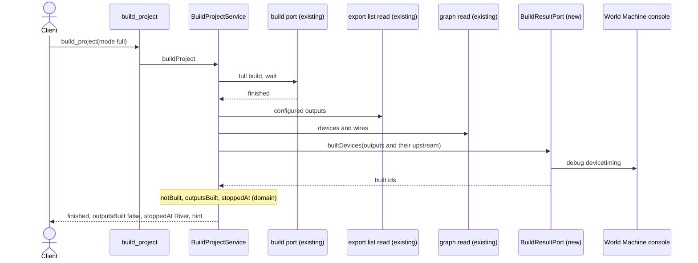

# worldmachine-mcp design: report outputs a full build did not build

Date: 2026-10-13
Status: draft, awaiting review
Builds on: [v2a design](2026-10-05-worldmachine-mcp-v2a-design.md) (`build_project`, `export_outputs`, facts 49-54, assumption A4) and [v3 design](2026-10-06-worldmachine-mcp-v3-design.md) (the graph read of `plan_graph`, fact 82, `resolveWireSource`). Backlog: lowlands trial, "`device add` can create a device at an old version that does not build" (docs/research/2026-10-05-plan1-backlog.md).

## 1. Purpose and scope

`device add` can create a device at an old version that does not build (River, Reach Scaling, and Perlin Curve; raw/river-failing-graph.txt). World Machine still prints `*** Build Ended ***`, `build_project` reports `finished`, and only `export_outputs` learns `Some output devices are not built`. A client finds out late, and is not told which device stopped the build.

This design makes `build_project` check, after a `full` build that finished within the wait, whether every output has a result, and name the devices where building stopped.

In scope: the check in `build_project`, a new outbound port and its adapter, a pure domain function, the fake World Machine, the view schema, tool text, and the README.

Out of scope: `preview`, `tiled`, and `group` builds (no capture of how they report); a `running` result; the same check in `get_build_status` (a new backlog item); reading or updating device versions (the console has no command for it).

## 2. Facts this design rests on

- Fact 92 (raw/build-not-built.txt, capture `build-not-built`, 2026-10-13): after a full build of Gradient into River into File Output (blank project) and of Gradient into File Output, these reads are the same for both graphs and so cannot tell a build that built nothing from one that built: `build status` (`Build started.`, `No build running.`, l.91-95 and l.263-267), `export list` (l.98, l.270), `device info`, `param list`, and the bare `debug` (debug variables only). Both builds print `*** Build Starting ***` and `*** Build Ended ***` with nothing between them. `help build`, `help debug`, and `help export` are at l.1-29.
- Fact 93 (raw/build-not-built-timing.txt, capture `build-not-built-timing`): `debug devicetiming #<id>` tells them apart. After the River graph's full build, the File Output and the River print `(no finished results)` (l.72-81) and the Gradient prints one row per result level, `129px`, `257px`, and `513px` (l.84-89; the scene resolution is 513). After the plain graph's full build, the File Output and the Gradient both print result rows (l.167-180). The summary `debug devicetiming` lists only devices with results (l.64-67, l.158-162), by name.
- Fact 94 (raw/build-not-built.txt l.183): World Machine's debug variable `build.purge_before_final = 1` purges all build results before a full build, so the results after a full build are that build's.
- Fact 95 (raw/build-stop-timing.txt, capture `build-stop-timing`): a full build ended by `build stop` (default project at 2049, stopped after 1.5 s) leaves lower result levels only: Advanced Perlin, Curves, Flow Restructure, and Easy Distortion show `129px` and `257px`, Erosion and Thermal Weathering `129px`, and none shows `2049px`. Devices it never reached, the outputs among them, print a third answer, `'<name>' has no build results yet.` (`'Height Output' has no build results yet.`). After a finished full build, `device select` of a built output and a two-second wait leave its rows unchanged (the previewer takes it as a target and stays idle). `scene show` prints the resolution (`Resolution:      2049`).
- Not captured: how `debug devicetiming` reports a disabled or bypassed device, a device that no output needs, or a `tiled` or `group` build.

## 3. When the check runs

Only when `build_project` was called with `mode: full` and the build reached `finished` within the wait. A full build ended by `stop_build` during the wait also reads as `finished` (README: a stopped build is reported as finished), so it is checked too, and its outputs usually report not built; the tool text says so. In every other case (`preview`, `tiled`, `group`, or `running`) the result is exactly as today.

## 4. The check

After the build ends:

1. `export list` gives the configured File Outputs by name (fact 49). They are matched to devices by the rule the exporter's `exportingAlways` uses (names cut at 23 characters in `device list`, fact 33; case-insensitive, fact 31). A name several devices share matches each of them; a name that matches no listed device fails the check (section 6), so an output that was not read can never count as built. With no configured outputs, the check ends: `outputsBuilt: true`, `notBuilt: []`, `stoppedAt: []`.
2. `scene show` gives the scene resolution, and `debug devicetiming #<id>` is read for every device in `device list`, in one batch, before any read that selects a device (`get_device` sends `device select`). A device is built when its table has a row at the scene resolution (`2049px` at 2049; fact 95: a stopped build leaves lower levels only), and not built when its table has no such row, when it prints `(no finished results)`, or when it prints `'<name>' has no build results yet.` Any other output is unexpected and fails the check (section 6).
3. The graph is then read as `plan_graph` reads it: devices with ids, names, types, enabled and bypassed, and wires whose sources are resolved by `resolveWireSource`.
4. `notBuilt` is every output without a result, `outputsBuilt` is `notBuilt` being empty, and `stoppedAt` is computed by the domain function `stoppedAt(graph, built, outputs)`: the devices without a result, on the input chain of an output without a result, whose wired inputs all have a result or which have no wired input. A device that no unbuilt output needs is never listed.

## 5. Result and MCP surface

For a full build that finished, `build_project`'s result gains:

- `outputsBuilt: boolean`;
- `notBuilt: [{ id, name }]`;
- `stoppedAt: [{ id, name, type, enabled, bypassed }]`;
- `hint`, only when `outputsBuilt` is false: `An output was not built. A device added from the console can be an older version that does not build; open the project in World Machine and update it in the Project Version dialog. A build ended by stop_build also leaves outputs not built.`

The `build_project` view schema admits these fields. The `build_project` description says that after a full build that finished within the wait the result reports whether every output was built and where building stopped, and that other modes and a `running` result are not checked. The README replaces "World Machine does not report a failed build" with the same.

## 6. Failure of the check

A `WorldMachineError` while checking (an `export list` or graph read error, an unexpected `debug devicetiming` answer, a check that cannot get the session) does not change the build's outcome: the result stays `finished`, the new fields are absent, and `outputsCheckError` carries the reason (the pattern of `apply_graph`'s `diffError`). Any other error is a defect and fails the call, as with `diffError`.

## 7. Structure

- Domain: `stoppedAt(graph, built, outputs)` in a new pure module, unit-tested.
- Application: a new outbound port `BuildResultPort` with one query, `builtDevices(ids)`, returning the ids with a result; `BuildProjectService` runs the check after a finished full build in a new exclusive section of the session (it releases the build's section before waiting); when that section cannot be had, the check reports `outputsCheckError`.
- Adapter: `WorldMachineBuildResultReader` implements the port with `debug devicetiming #<id>` and a parser for its two shapes (fact 93); outputs come from the existing `export list` read.

## 8. Testing

- Domain: `stoppedAt` on a chain stopped at its middle device, a branch that built beside one that did not, a device no output needs, a device without inputs, and no outputs.
- Parser: both `debug devicetiming #<id>` shapes, verbatim from raw/build-not-built-timing.txt.
- Service: a finished full build reports the fields; `preview`, `tiled`, `group`, and `running` do not; a failing check gives `outputsCheckError` and `finished`.
- Fake World Machine: `debug devicetiming #<id>` prints the captured table, with result rows at 129, 257, and 513 px or `(no finished results)`. After a full build a console-added River and every device downstream of it have no result; every other device has one (fact 93). Disabled and bypassed devices follow a rule marked `Assumed:`.
- Through the fake: the River graph gives `outputsBuilt: false`, `notBuilt` the File Output, and `stoppedAt` the River; the plain graph gives `outputsBuilt: true`.
- MCP: the view schema admits the fields; the description names the check.
- Live (`WM_LIVE=1`, after the user approves the run): the same two graphs in blank projects.

## 9. Documentation

README: the build bullet. Backlog: the lowlands item becomes `Done:`, and a new `Open:` item records the same check in `get_build_status` for a full build that outlived the wait.
