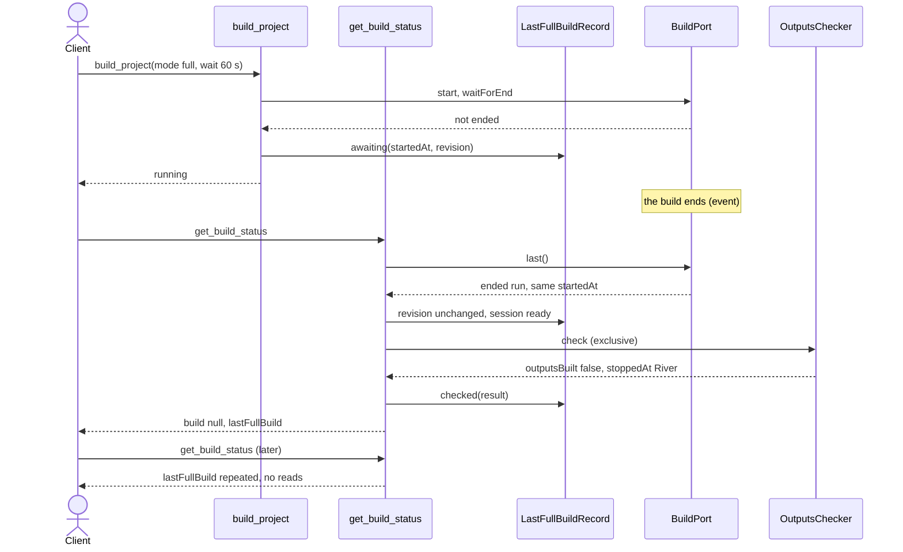

# worldmachine-mcp design: report a finished full build's outputs in get_build_status

Date: 2026-10-13
Status: draft, awaiting review
Builds on: [build-not-built design](2026-10-13-worldmachine-mcp-build-not-built-design.md) (the output check, sections 4-6; facts 92-96) and [v2a design](2026-10-05-worldmachine-mcp-v2a-design.md) (`build_project`, `get_build_status`, the build tracker). Backlog: "`get_build_status` does not check the outputs" (docs/research/2026-10-05-plan1-backlog.md).

## 1. Purpose and scope

A `full` build that outlives `build_project`'s wait is reported `running`. Once it ends, nothing reports whether every output was built; the client learns it only from `export_outputs`.

This design makes `get_build_status` report the outcome of the last full build that `build_project` started: whether every output was built and where building stopped. The check is the one `build_project` runs (build-not-built design, sections 4-6), run at most once per build, and its result is repeated by later calls.

In scope: a record of the last server full build, a project revision counter in the session, `BuildPort.last()`, the extraction of the check into a shared application component, `get_build_status`'s view schema and description, `build_project`'s description, the README, and the backlog.

Out of scope: `preview`, `tiled`, and `group` builds, and full builds started in the World Machine window (no check in `build_project` either; the window case also rests on an uncaptured assumption, README); re-checking a stored result; edits made in the World Machine window.

## 2. Facts this design rests on

- Facts 92-96 (build-not-built design, section 2): `debug devicetiming #<id>` tells a built device from an unbuilt one, and `build.purge_before_final = 1` makes the results after a full build that build's.
- Spec v2a section 4: every command use case is refused while a full or tiled build runs (`exclusive()` throws `REFUSED`), so the project does not change between the start of a full build and its end through this server.
- Every change a command use case makes calls `markDirty()` on the session; opening, creating, and closing a project call `bind()`. Saving also calls `bind()`, with the same graph.
- The build tracker belongs to one World Machine process; a new process has a new tracker with no last run. Build results live in that process only.
- Assumed: a preview build between a full build's end and the check leaves the rows at the scene resolution in place (not captured).

## 3. The record

The server keeps one in-memory record, `LastFullBuild`, of the last full build `build_project` started. It holds the run's `startedAt`, the project revision when the build started, and a state: `awaiting` (the build outlived the wait), `checking` (a check is running; concurrent calls share it), or `checked` (a result, section 5).

| Event | Effect on the record |
|---|---|
| `build_project` mode `full` reaches `finished` within the wait | `checked` with the result `build_project` returns, `outputsCheckError` included |
| `build_project` mode `full` returns `running` | `awaiting`, with the run's `startedAt` and the revision captured when the build started (equal to the revision at its end, section 2) |
| `get_build_status`, record `awaiting`, `BuildPort.last()` has the same `startedAt` and has ended (finished or stopped), revision unchanged, session `ready` | the check runs (section 4), then `checked` |
| as above, revision changed | `checked` with `outputsCheckError: "The project changed after the build ended; run build_project again."`, without reads |
| as above, session not `ready` | `checked` with `outputsCheckError: "World Machine is not running; the results of that build are gone. Run build_project again."`, without reads |
| `BuildPort.last()` is a different run, or none (a new build of any tracked mode, a new World Machine process, `forgetRun`) | cleared |
| `bind()` to another project (open, create, close) | cleared |
| any other call | unchanged; `get_build_status` repeats a `checked` result without reads |

A full build ended by `stop_build` counts as ended and is checked, as in `build_project` (build-not-built design, section 3); its outputs usually report not built, and the hint says so.

## 4. The check

The check is the one of the build-not-built design, sections 4 and 6, unchanged: `export list`, `scene show`, `debug devicetiming #<id>` for every device in one batch, the graph read, and the domain function `checkOutputs`, in its own `exclusive()` section. It is extracted from `BuildProjectService` into a shared application component, `OutputsChecker`, which both services call.

`get_build_status` takes `exclusive()` only when a check is due; every other call stays a read of `build status` and in-memory state, as today. The check never starts World Machine (section 3, session not `ready`).

Errors follow the build-not-built design, section 6:

- a `WorldMachineError` while checking becomes `outputsCheckError` and is stored (`checked`); the call succeeds;
- any other error is a defect: it fails the call, and the record goes back to `awaiting`.

When the check cannot get `exclusive()` because another build started, the record clears on the next call (section 3), so nothing is stored for the old run.

## 5. Result and MCP surface

`get_build_status`'s result gains `lastFullBuild`, present only when the record is `checked`:

- `startedAt: string` (ISO 8601), the run the result belongs to;
- `outputsBuilt`, `notBuilt`, `stoppedAt`, and `hint` exactly as `build_project` reports them (build-not-built design, section 5), or `outputsCheckError` instead of them.

While a build runs, `build` is set as today and `lastFullBuild` is absent. The view schema reuses `build_project`'s schemas for `notBuilt` and `stoppedAt` and the domain's hint text.

The `get_build_status` description gains: `After a full build that build_project started has ended, also reports whether every output was built and where building stopped (lastFullBuild). The first call after a build that outlived build_project's wait runs that check; later calls repeat it. If this server changed the project after the build ended, the check is skipped. Edits made in the World Machine window are not seen.`

The `build_project` description's sentence on a `running` result gains: `get_build_status reports the check once the build ends`. The README's build bullet gets the same.

## 6. Structure

- Application: `OutputsChecker`, the check extracted from `BuildProjectService` with its error rule. `LastFullBuildRecord`, holding the record, with a pure transition core (section 3) and one instance shared by `BuildProjectService` and `GetBuildStatusService`, wired in `main.ts`.
- Outbound ports: `BuildPort.last()` returns the tracker's last run, running or ended (`current()` keeps returning the running run only). `WorldMachineSessionPort.projectRevision()` returns a counter that `markDirty()` and a `bind()` to another project bump, and that a save does not. How a save's `bind()` is told apart is settled in the plan.
- Services: `BuildProjectService` writes the record after the wait. `GetBuildStatusService` resolves the record, runs `OutputsChecker` when a check is due, and maps the record to `lastFullBuild`.
- MCP: `buildStatusViewSchema` admits `lastFullBuild`; both descriptions change (section 5).

## 7. Testing

- Record: every row of the section 3 table; two concurrent `get_build_status` calls share one check.
- Session: the revision bumps on `markDirty`, open, create, and close, and not on save.
- Services, with stub ports: an outlived build is checked once and repeated without a second read; an edit between the end and the check gives the "project changed" error without reads; a session not `ready` gives the "results are gone" error; a `WorldMachineError` is stored and any other error leaves the record `awaiting`; a new build clears the record; a build that finished within `build_project`'s wait is repeated by `get_build_status`; `build_project`'s results are unchanged.
- Through the fake World Machine: the River graph with a wait shorter than the fake's build gives `running`, then `get_build_status` after the end gives `outputsBuilt: false`, `notBuilt` the File Output, and `stoppedAt` the River; the plain graph gives `outputsBuilt: true`; an `update_device_parameters` call before `get_build_status` gives the "project changed" error.
- MCP: the view schema admits `lastFullBuild`; the descriptions name the check.
- Live (`WM_LIVE=1`, after the user approves the run): the River graph in a blank project, a full build with a wait shorter than the build, then `get_build_status`.

## 8. Documentation

README: the build bullet (section 5). Backlog: the `get_build_status` item becomes `Done:`.
