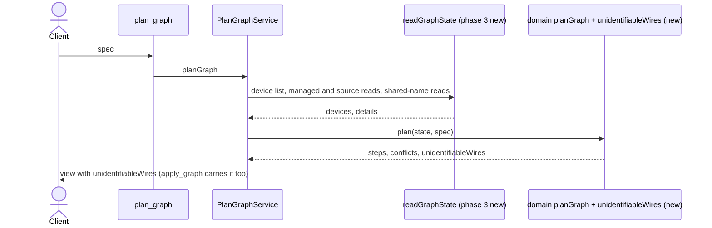

# worldmachine-mcp design: wires a later plan cannot identify

Date: 2026-10-14
Status: draft, awaiting review
Builds on: [v3 design](2026-10-06-worldmachine-mcp-v3-design.md) revision 6 (`resolveWireSource`, fact 82, section 5) and the [port-types design](2026-10-13-worldmachine-mcp-port-types-design.md) (`uncheckedWires`, the pattern for a plan-view list that does not refuse). Backlog: docs/research/2026-10-05-plan1-backlog.md l.108.

## 1. Purpose and scope

`wire list` names the devices at both ends of a wire, never their ids. When several devices share an input's source name, `resolveWireSource` picks the source by the candidates' output targets (fact 82). That fails when two devices of one name each feed the same input number of two devices that also share a name. The common case is Combiners, which World Machine never renames (fact 80): Combiner #10 into Combiner #20 input 1 and Combiner #11 into Combiner #21 input 1 each list "`Combiner` input 1" among their targets, so the source of either input is `ambiguous`.

Today `plan_graph` reports nothing, `apply_graph` builds the wiring, and from then on every plan of the same spec reports a conflict on those inputs, and `disconnect_devices` refuses those wires (README, `plan_graph` description).

This design makes `plan_graph` predict the wiring after apply and list every wire into a managed device that a later plan could not identify, as a warning. `apply_graph` still applies the spec, since World Machine handles the wiring; the client sees the cost before it is paid.

In scope: a third read phase in `readGraphState`, a pure prediction module, the plan and apply views and their schemas, tool text, README, and backlog.

Out of scope: refusing such a spec; changing how a later plan treats an existing wire it cannot identify (it stays a conflict, v3 revision 6); wires between unmanaged devices; renaming devices to avoid the case.

## 2. The prediction

`unidentifiableWires` (`src/domain/wire-prediction.ts`, pure) takes the read state and the plan's steps and builds the state after apply:

- Devices: the listed devices less the removed ones, plus one per `add` step, with a placeholder id below zero and its predicted listed name: the entry's name (an added Combiner is named exactly `Combiner`, v3 revision 6, so the rule needs no special case).
- Output targets: each read device's current targets, less each `disconnect` step's wire and every wire of a removed device, plus each `connect` step's wire, with the destination's predicted listed name and input port. An added device starts with no targets.
- Inputs: each managed device's inputs as they will be: a `connect` step sets the source (its predicted listed name and port), a `disconnect` step clears it, others keep their current source.

For every wired input of a managed device in that state, it runs the unchanged `resolveWireSource` with the predicted device list and outputs. An input is listed when the prediction is `ambiguous` and the input is not already a conflict of the plan (an existing wire the plan cannot identify keeps its conflict and is not listed twice). `found`, `none`, and `unknown` are not listed.

Each entry is one string: `'<entry>' input <q> from '<source name>' output 
: <candidates> each list '<destination listed name>' input <q>`, where a candidate is `#<id>` for an existing device and `the planned '<entry>'` for an added one, joined as `candidateIds` joins ids. The list is in step order of the destination entries, then input port; empty when nothing is listed.

## 3. Reads

The prediction needs the outputs of every existing device whose listed name a predicted wire's source has, when two or more devices (existing or planned) share that name. `readGraphState` gains a third phase after the two of v3 section 5: for each spec input wire whose source's predicted listed name is shared by two or more predicted devices, every existing device of that name not read yet is read with `get_device`. The ids are computed once, from the spec, the device list, and the details of phases one and two. A spec without a shared source name reads nothing more.

## 4. MCP surface

- `plan_graph`: the view gains `unidentifiableWires: string[]` (required, possibly empty). It adds no conflict.
- `apply_graph`: unchanged in what it does; its view gains the same field, copied from the plan it applied (empty when it refused).
- Descriptions: the `plan_graph` and `apply_graph` descriptions replace the sentence about a wiring a later plan cannot resolve with one sentence on `unidentifiableWires`; README likewise.
- Backlog l.108 becomes `Done:`.

## 5. Structure

- Domain: `src/domain/wire-prediction.ts` (the prediction and the entry text); the third-phase id function next to `sharedSourceIds` in `graph-plan.ts`.
- Application: `readGraphState` runs the third phase; `PlanGraphService` and `ApplyGraphService` put the list in their views; `PlanGraphView` and `ApplyGraphView` gain the field.
- MCP: `planGraphViewSchema` and `applyGraphViewSchema` gain the field.

## 6. Testing

- Domain: two Combiner-into-Combiner pairs on input 1 that the plan wires (existing Combiners managed by `id`) are listed (both inputs); one pair is not; two pairs on different input numbers are not; an existing managed wire that a planned sibling pair makes ambiguous is listed; an input that is already a conflict is not listed; a `disconnect` step or a removed device that clears an ambiguity leaves it unlisted; a candidate that is planned is named `the planned '<entry>'`.
- Read phase: phase three reads exactly the unread existing devices of a shared predicted source name, and nothing for a spec without one.
- Services and schemas: both views carry the field; apply copies its plan's list; a view without it is refused by the schema.
- Fake World Machine, end to end: plan two Combiner pairs (warning listed), apply, plan again (the conflict of today), which pins what the warning predicts.
- Live (`WM_LIVE=1`, after the user approves the run): the same scenario in a blank project.

## 7. Documentation

README and the two descriptions as in section 4; backlog l.108 `Done:` with the commits.

Revision 1 (2026-10-14, plan drafting): an added device never shares its listed name with another device (entry names are unique, and an entry whose name an existing device has manages it), so a planned device is never a candidate and the Combiner pairs of section 6 are existing Combiners the spec manages by `id`; the `the planned '<entry>'` wording stays for completeness. The backlog item is l.108.
