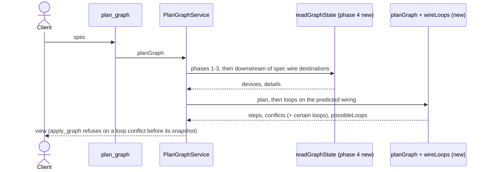

# worldmachine-mcp design: loops detected by plan_graph

Date: 2026-10-14
Status: draft, awaiting review
Builds on: [v3 design](2026-10-06-worldmachine-mcp-v3-design.md) (planning, applying, conflicts), [unidentifiable-wires design](2026-10-14-worldmachine-mcp-unidentifiable-wires-design.md) (the predicted wiring after the apply, a warning list beside conflicts, the read phases), facts 98 and 99 (docs/superpowers/specs/2026-10-13-worldmachine-mcp-build-not-built-design.md section 2). Backlog: docs/research/2026-10-05-plan1-backlog.md l.130.

## 1. Purpose and scope

World Machine refuses a `wire connect` that would close a loop, with `Error: Error: These ports cannot be connected as the result will create a cycle in the graph!` (fact 99, raw/wire-cycles.txt). `plan_graph` does not see it: a spec whose wires, with the wires the project keeps, close a loop plans cleanly, and `apply_graph` takes a snapshot, fails at the closing connect, and rolls back. Nothing breaks, but the loop is found late.

This design makes `plan_graph` find such loops: a loop it can follow with certainty is a conflict, so `apply_graph` refuses before its snapshot; a loop that depends on a wire whose device it cannot identify is a warning.

In scope: a fourth read phase, a pure loop module, the plan and apply views and schemas, tool text, README, backlog.

Out of scope: a self-wire (fact 98; already a conflict, unchanged); `connect_devices` (World Machine's sentence already reaches the client, fact 99); loops among devices no spec wire reaches.

## 2. Finding a loop

The search runs on the wiring predicted after the apply, the model `unidentifiableWires` builds (unidentifiable-wires design section 2): the listed devices less removed ones plus added ones, each read device's output targets less disconnected and removed wires plus the plan's connects, and each managed input's source as it will be. That model is extracted into one shared function, used by both modules.

For each `connect` step `S.p -> D.q`, a loop exists when a path leads from D to S along output targets in that model. A target names a device by listed name and input port. A hop is certain when that name is one device's, or when `resolveWireSource` on the named device's input identifies the hop's source as `found`; otherwise the hop may reach every device of that name, and the path through it is uncertain.

- A path from D to S whose hops are all certain is a loop: a conflict on D's entry, `input <q> from '<S>' output 
 would close a loop (<D> -> ... -> <S>); World Machine refuses a wire that closes a loop (fact 99)`, naming devices as the plan names them (spec entry, label, or listed name with `#<id>` where names repeat). When several of the plan's connects lie on one loop, each gets the conflict.
- Otherwise, a path from D to S with an uncertain hop puts the wire in `possibleLoops`: `'<D entry>' input <q> from '<S>' output 
 may close a loop through '<shared name>', whose wires cannot be told apart`. It refuses nothing.
- No path: nothing.

A self-wire (S equals D) is left to the fact 98 conflict and is not reported again. A connect the plan already refuses (it has no step) is not searched. The search is depth-first, visits each device once per connect, and keeps the first path it finds for the text.

Bias: a conflict rests only on certain hops, so a spec World Machine would accept is never refused; reads are complete downstream (section 3), so a loop is never left unreported.

## 3. Reads

`readGraphState` gains a fourth phase after the three it has, run only when the spec has input wires. Starting from the destination devices of the spec's input wires (existing devices only), it reads, in rounds, every device not read yet that it reaches: from each read device it follows its output targets by listed name and takes every listed device of that name, until a round finds nothing new. Each device is read at most once per plan. The phase is computed from the spec and the reads, not from the plan's steps, so it may read slightly more than the search uses, never less; a spec without input wires reads nothing more. `planId` covers every detail read and `apply_graph` repeats the same reads when it plans again.

## 4. MCP surface

- `plan_graph`: certain loops are conflicts in `conflicts`; the view gains `possibleLoops: string[]` (required, possibly empty).
- `apply_graph`: refuses a plan with a loop conflict before its snapshot, as for any conflict; its view gains `possibleLoops`, copied from the plan it applied.
- Descriptions: `plan_graph` and `apply_graph` each gain one sentence; README likewise.
- Backlog l.130 becomes `Done:`.

## 5. Structure

- Domain: `src/domain/predicted-wiring.ts` (the model extracted from `wire-prediction.ts`, which then uses it), `src/domain/wire-loops.ts` (`wireLoops(spec, state, steps)` returning `{ conflicts, possibleLoops }`), and the phase-four id function next to `predictedSourceIds` in `graph-plan.ts`.
- Application: `readGraphState` runs phase four; both services add the loop conflicts and the list.
- MCP: `planGraphViewSchema` and `applyGraphViewSchema` gain `possibleLoops`.

## 6. Testing

- Domain: a two-device loop and a three-device loop through an unmanaged device are conflicts; two new connects that close one loop together each get the conflict; a chain without a loop gives nothing; a loop through a shared name that cannot be identified is listed in `possibleLoops` and is no conflict; a wire the plan disconnects, or a removed device on the path, breaks the loop; a self-wire keeps only its fact 98 conflict; a connect the plan refuses is not searched; `unidentifiableWires` is unchanged after the extraction (its tests stay green unmodified).
- Read phase: reads exactly what the destinations reach downstream plus devices sharing those names; nothing more for a spec without input wires.
- Services and schemas: `possibleLoops` in both views; `apply_graph` refuses a loop before any snapshot or change command.
- Fake World Machine (which refuses loops, fact 99), end to end: the plan reports the conflict; apply refuses without sending a change.
- Live (`WM_LIVE=1`, after the user approves the run): a two-device loop in a blank project.

## 7. Documentation

README and the two descriptions as in section 4; backlog l.130 `Done:` with the commits.
