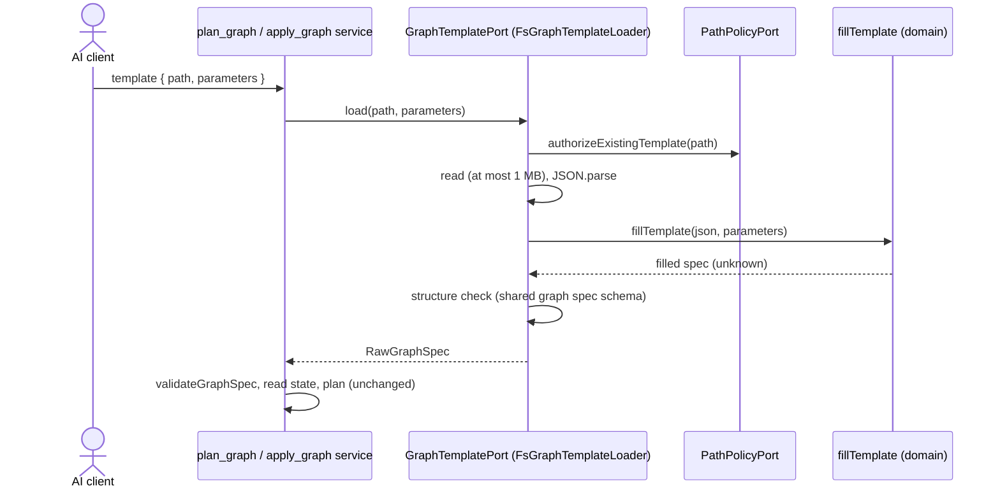

# worldmachine-mcp design: graph spec templates on disk

Date: 2026-10-15
Status: draft, awaiting review
Builds on: [v3 design](2026-10-06-worldmachine-mcp-v3-design.md) (the graph spec, validation, planning, `planId`, applying; revision 9 points here and amends section 10), [v1 design](2026-10-04-worldmachine-mcp-design.md) (the allowed roots and path rules of `open_project`). Backlog: docs/research/2026-10-05-plan1-backlog.md, section "v3 out-of-scope features", the item on spec files and templates on disk.

## 1. Purpose and scope

A graph spec today is passed inline to `plan_graph` and `apply_graph`. This design lets a spec live in a file and be reused with different values: a template is a `.json` file inside the allowed roots that declares typed parameters and uses them anywhere in its spec. `plan_graph` and `apply_graph` take the template's path and arguments instead of an inline spec, fill the template, and then plan and apply the result exactly as an inline spec.

In scope: reading a template by path, typed parameters with defaults, filling, and the stale-file guarantee. Out of scope: listing or saving templates (a person or another tool writes them), formats other than JSON, arguments of object or array type, object keys as parameters, and nested templates or includes.

## 2. The template file

A template is a `.json` file of at most 1 MB, UTF-8, at an absolute path inside the allowed roots:

```json
{
  "template": 1,
  "description": "Eroded hills at a chosen resolution",
  "parameters": {
    "resolution": { "type": "integer", "default": 1025, "description": "Render resolution" },
    "seed": { "type": "integer" }
  },
  "spec": {
    "version": 1,
    "scene": { "resolution": { "$param": "resolution" } },
    "devices": [
      { "name": "Base", "type": "Advanced Perlin", "parameters": { "seed": { "$param": "seed" } } }
    ]
  }
}
```

- `template` is required and must be `1`.
- `description` is optional free text, never interpreted.
- `parameters` is optional; each entry is `{ "type", "default"?, "description"? }`. `type` is one of `number`, `integer`, `string`, and `boolean`. `default`, when given, must have that type (`integer`: a safe whole number).
- `spec` is required: a graph spec (v3 section 4) in which values may be references.
- A file whose top level has no `template` key is read as a plain spec, that is a template without parameters whose `spec` is the whole file.

### References

Any JSON value inside `spec`, at any depth, may be `{ "$param": "<name>" }`: an object whose only key is `$param` and whose value is a declared parameter's name. Filling replaces the object with the argument's value. Object keys are never replaced, so a parameter name, an input port, or a field name cannot be a parameter. Since arguments are scalars, a template varies values (numbers, strings, booleans, device names, sources, ids, scene fields) but not the shape of its JSON.

### Filling rules

`fillTemplate` refuses with `REFUSED`, naming the template path and the offending parameter or JSON path:

- the file is not a JSON object, or `template` is present and not `1`, or `spec` is missing;
- a parameter declaration is not an object, has an unknown `type`, or has a `default` of another type;
- a `$param` names a parameter that is not declared; an object has `$param` beside other keys; `$param`'s value is not a string;
- a declared parameter that no `$param` uses (most likely a typo in the template);
- an argument for a parameter that is not declared; a declared parameter without a default and without an argument; an argument of another type than declared (`integer`: a safe whole number; `number`: a finite number).

The filled spec is then an ordinary raw spec: it passes the same structure check as an inline `spec` (the zod schema of the MCP adapter), then `validateGraphSpec`, so every v3 rule applies unchanged (names, decimals, ids, `rename`, `scene`).

## 3. Tools

`plan_graph` and `apply_graph` take exactly one of:

- `spec`: the inline spec, as today;
- `template`: `{ "path": "<absolute path to a .json file>", "parameters": { "<name>": <string | number | boolean> } }`, `parameters` optional.

Both or neither is `REFUSED` before anything is read. `plan_graph`'s result gains `spec`, the filled raw spec, only when the call gave `template`; its other fields are unchanged. `apply_graph`'s result is unchanged.

### `planId` and a changed file

`planId` (v3 section 5) hashes the validated spec, so it covers the filled result; the template path is not hashed. `apply_graph` loads and fills the template again: when the file or an argument changed since `plan_graph` so that the filled spec differs, the `planId` differs and the apply is refused as stale, as for any changed spec. A copy of the same template at another path, with the same arguments, plans identically. An edit that leaves the filled spec equal (a changed `description`) does not change the `planId`.

## 4. Paths

`PathPolicyPort` gains `authorizeExistingTemplate(input): Promise<string>`, with the rules of `authorizeExistingProject` (v1): an absolute path; `realpath` resolves it; the resolved file lies inside an allowed root; it is a regular file; its extension is `.json` (any case). Refused otherwise with `Not an existing .json template file inside the allowed roots: <input>`. The returned canonical path is the one read.

## 5. Structure



- `src/domain/graph-template.ts`: `fillTemplate(file: unknown, args: Readonly<Record<string, string | number | boolean>>, path: string): unknown`, pure; every rule of section 2.
- `src/application/port/out/graph-template-port.ts`: `GraphTemplatePort { load(path: string, parameters: Readonly<Record<string, string | number | boolean>>): Promise<RawGraphSpec> }`.
- `src/adapter/out/fs/graph-template-loader.ts`: `FsGraphTemplateLoader` (path policy, size limit, read, parse, fill, structure check). Unreadable file, a file over 1 MB, and invalid JSON are `REFUSED` naming the path and the reason.
- The graph spec zod schema moves from `src/adapter/in/mcp/schemas.ts` to a shared adapter module, so the inbound MCP adapter and the outbound loader use one schema and neither adapter imports the other.
- `PlanGraphQuery` and `ApplyGraphCommand` carry `spec?` and `template?`; the services resolve the spec first (exactly one; inline, or `GraphTemplatePort.load`) and then run unchanged. The template is loaded before `apply_graph`'s exclusive section; no World Machine command is involved.
- `PathPolicyPort.authorizeExistingTemplate` in `src/adapter/out/fs/path-policy.ts`.
- `main.ts` wires the loader into both services.

## 6. Testing

- Domain: a `fillTemplate` table, one row per refusal rule of section 2; fills of a reference at depth, in a device name, in an input source, and in a scene field; a default used and a default overridden; an integer argument of 1.5 refused; a plain spec file without `template`.
- Path policy: a `.json` file inside a root accepted; a relative path, a path outside the roots, a symlink inside a root pointing outside, a directory, and a `.tmd` file refused.
- Loader: a file over 1 MB refused, invalid JSON refused, a filled spec that fails the structure check refused, a valid template returned as `RawGraphSpec`.
- Services through the fake World Machine: plan a template and apply it with the same arguments; the file changed between plan and apply so that the filled spec differs, refused as stale; other arguments give another `planId`; a changed `description` keeps the `planId`; both `spec` and `template`, and neither, refused before any World Machine command.
- MCP: the input schemas accept `template` and refuse unknown keys in it; `plan_graph`'s result carries `spec` only for a template call.
- No live run: no World Machine behaviour changes.

## 7. Documentation

The README's declarative-graphs section gets a template example, the parameter types, the `$param` rule, the path rule, and the stale-file behaviour. The `plan_graph` and `apply_graph` descriptions name `template` beside `spec`. The v3 spec gets revision 9, pointing here and removing "templates and spec files on disk" from section 10.
