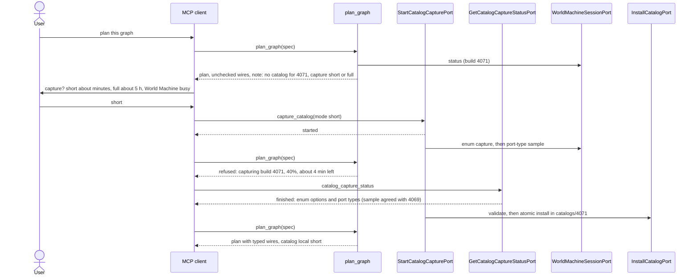

# User-built catalogs (design)

Date: 2026-11-17. Status: draft for review.

## Intent

The server ships an enum-options catalog and a port-type catalog per World Machine build (4067 and 4069 today). Each
new build has meant a capture on the maintainer's machine, a release, and a wait for users. The maintainer will not
compile a catalog for every future build, and will not accept or host catalogs that users send in.

This design lets a user on a build the server has never seen capture the catalogs on their own machine, from inside the
server, and use them from then on. Catalogs a user captures stay on that user's machine.

The moment it is built for: someone installs the server on, say, build 4071 and calls `plan_graph` for the first time.
The call answers at once, as it does today on an unknown build, and tells them that a catalog can be captured, how long
it takes, and that World Machine is busy meanwhile. They choose to start it.

## Goals

1. A user on an uncatalogued build can capture the enum-options and port-type catalogs through MCP tools, without the repository or its scripts.
2. Capture modes:
   - **short** (the default): the enum capture plus the port-type sample, checked against the closest shipped catalog
     and derived from it the way `port-types.4069.json` was (`scripts/derive-port-type-catalog.mjs`);
   - **full**: the enum capture plus the complete port-type probe (about 277 minutes of probing on 4069, plus adding and
     listing; see `test/fixtures/wm-4069/raw/port-types-sample.txt`, section `(timing)`).
3. A captured catalog is stored locally per build and used like a shipped one.
4. A catalog derived from a sample (the shipped 4069 one, and any short local capture) treats a conflict as a warning,
   and learns from World Machine's verdicts on real wires.
5. A capture never silently damages a catalog that worked (the anti-goal below).

## Non-goals

- Sending catalogs back to the project, hosting them, or sharing them between users.
- Removing the shipped catalogs; 4067 and 4069 stay in the package.
- Capturing anything other than enum options and port types (for example console grammar changes such as the 4069
  wire-list padding; those still need a release).
- Correcting enum-option catalogs from use. Only port types learn.

## Anti-goal

**A capture that silently corrupts a working catalog.** Every rule under "Safety of catalog files" exists for this. A
technically working feature that can replace a good catalog with a worse one without the user noticing has failed.

## Decisions

Marked (user) where the maintainer decided it in the brainstorm on 2026-11-17, (designer) where it is the designer's call
and open to change.

### D1. The first moment (user, with designer detail)

- On a build with no catalog (shipped or local), `plan_graph` and `get_device` behave as today: enum options omitted,
  wires with an untyped end listed in `uncheckedWires`. (designer)
- Their response carries a note naming the build and offering a capture, with the `short` and `full` modes and their duration, and saying
  that World Machine is occupied for the whole run and the mouse pointer must stay off its window. (user: warn first)
- Starting the capture tool is the confirmation; the server does not start a capture on its own. (designer; an MCP tool
  call cannot stay open for hours, so `plan_graph` must not wait for a capture)

### D2. Capture modes (user)

- `short` is the default, `full` on request.
- `short`: enum capture, then the port-type sample (the lean sample of `port-types-sample.txt`: every type added once,
  its ports listed, and a few hundred output and input pairs), checked against the closest shipped catalog.
  - The base is the closest **strict** catalog (D5): the shipped 4067 catalog or a local full capture, the highest
    build below the new build, else the lowest. A sample-derived catalog is never a base, and corrections are not
    applied to the base before the check, so one sample assumption is never stacked on another and the gaps of 4069
    (no Bias/Gain, no VDM Noise) are not carried forward. Today the base is always 4067. (designer)
  - A base type the sample could not add (an omitted type, as Bias/Gain and VDM Noise were for 4069) is not a
    disagreement: it is left out of the derived catalog and named in the result and in `capture.json`. (designer,
    following how 4069 shipped)
  - A sampled type the base lacks is not a disagreement either: it gets no port types, and the result and
    `capture.json` name it. Today `derivePortTypeCatalog` throws on it (`not in the build 4067 catalog`); that changes.
    (designer)
  - When the sample agrees (same ports for every sampled type, every verdict as the base classes predict), the local
    port-type catalog is derived as for 4069: base ports and classes, the add words the new build accepted, moved words
    recorded.
  - When it disagrees, the local catalog holds enum options only, and the capture result names the first
    disagreement (type and ports, or the pair and both verdicts) and suggests a full run. No port types are used for
    that build. (designer)
- `full`: enum capture, then every output wired to every input, as `scripts/capture-fixtures.mjs` and
  `scripts/build-port-type-catalog.mjs` do now, including the twin pass (a second device of each type, for its own
  inputs; `port-types-self.txt` for 4067). Without it the catalog has holes and `parsePortTypeCatalog` refuses it.
  (designer)
  - Complete means: every type the build accepted an add word for is listed, and every pair among those types is
    probed. It is measured against what this build accepted, not against the 4067 word list. Words the build refused
    are named in the result. (designer)
  - Class names: the shipped 4067 catalog names its classes from `scripts/port-type-names.4067.json`, a hand-made map.
    A local full run names each class after the class of the closest catalog that holds the same `Type.Output`
    members, and gives a generated name (for example `class 7: Create Water.Water System, ...`) to a class with no
    match. (designer)

### D2a. Discovering device types (user: discover; designer: approach)

- A capture tries to discover device types the build has that no catalog knows, instead of adding only the 4067 add
  words and the fixed enum type list. (user)
- Planned source (designer): since 4069 the console refuses an ambiguous add word and lists every device type it
  matches, for example `Tag 'Brightness' matches multiple devices: Adjust Color, Bias/Gain, Gamma, Levels, Report
  Color, Select Color`. The 4069 fixtures alone name 74 distinct types this way. Discovery probes tags, collects
  every listed name, and adds each new type by its own name.
- Measured on 4069 (live probe, 92 tags): the console matches whole tags only, so single letters and `*` give
  `Device type not found`. The probe reached 69 types, against 118 in the 4067 catalog. Discovery is best effort and
  never claims a complete type list.
- Checked outside the product: build 4069 registers 138 device types. Some have no tags at all (deprecated types, macro
  internals, and a few live ones), so no tag reaches them. Hidden types are refused by `device add` (`Cannot add hidden
  device type.`) and are not catalog types.
- Discovery uses the console only (see Constraints).
- Discovery tries, in order: tags from the closest catalog's add words and type names, then each known type by its own
  name. Types it does not reach, including every type known to a catalog but not added on the build, are named as not
  captured in the result and in `capture.json`. A type that no catalog knows and no tag reaches cannot be named; the
  result says only that discovery is incomplete for this build.
- Some types report a name that depends on their parameters: on 4069 a Clamp lists as `Rescale (Clamp)`, and
  Coordinate Generator, Integer Generator, Reach Scaling, Displacement, Material Map, Scalar Generator, Curve Chooser,
  and the VDM remap device have more than one name. A catalog keys a type on the name that adds it; names a device
  reports otherwise are kept as aliases of that type, never as new types. (designer)
- Outside dependency: a console command that lists device types would make discovery complete. The maintainer asks
  World Machine's developer for one; until it exists, discovery stays incomplete.
- A build without the ambiguity error (4067 and earlier) falls back to the known word lists.
- A discovered type gets enum options in `short` and `full`. It gets port types in `full`; in `short` it has none, since the
  base catalog has no classes for it, and the result names it (D2).

### D3. Running a capture (designer)

- A capture runs in the background inside the server process and owns the World Machine session for its duration.
- While it runs, every tool that needs World Machine is refused at once with the build, the mode, the progress, and the
  estimated time left. Tools that need no World Machine still answer. No call queues behind a capture.
- A status tool reports progress; a cancel tool stops the run.
- A cancelled or crashed run keeps its partial transcript, and the next capture of the same build and mode resumes from
  it (the 4067 full run needed a resume). A capture survives neither a server restart nor a World Machine crash as a
  running job; it resumes on the next start of the capture tool.
- The capture checks for the conditions captures already need: no project changes pending (it starts with
  `project new blank force`, so the tool warns that an open project is closed first, and refuses when the open project
  has unsaved changes unless told to discard them), and selection behaviour on 4069 and later (it should not select
  devices, as the server no longer does on 4069).

### D4. Where catalogs live and which one applies (user: local; designer: details)

- One folder per build under the user's config directory, by default `$XDG_CONFIG_HOME/worldmachine-mcp/catalogs/<build>/`
  (`~/.config/...` when unset; the platform equivalent on Windows and macOS), overridable by an environment variable
  next to the existing ones.
- Files in a build folder: `enum-options.json`, `port-types.json`, `port-type-corrections.json`, and a `capture.json`
  recording mode, date, server version, base build for a short run, and the outcome of the sample check.
- Lookup per build, first match wins: shipped strict, local full, shipped sample-derived, local short. So a local
  full capture on 4069 replaces the shipped sample-derived 4069 catalog for that user (the full 4069 run stays
  possible, as decided for 4069 on 2026-11-17), while nothing local overrides the shipped 4067 catalog. Local
  corrections apply on top of the catalog in use when it is sample-derived. (designer)
- `capture_catalog` refuses when the build already has a strict catalog (shipped or local full), and refuses `short`
  when the build already has any catalog of equal or better standing. (designer)
- `get_device` and `plan_graph` say where their catalog came from: shipped, local short, or local full, and whether
  corrections apply.

### D5. Strict and sample-derived catalogs (user)

- Strict: the shipped 4067 catalog and any local full capture. A conflict is a conflict: `apply_graph` refuses the spec
  as today.
- Sample-derived: the shipped 4069 catalog and any local short capture. `plan_graph` lists a conflict as a warning
  (a new field beside `conflicts`, so a client can tell them apart), and `apply_graph` sends the wire. If World Machine
  refuses it, the error is World Machine's own, as with `connect_devices` today.
- The catalog file records which kind it is, so the server does not infer it from the build.

### D6. Learning from World Machine (user: both directions; designer: details)

Applies to sample-derived catalogs only.

- World Machine accepts a wire the catalog called a conflict: the pair (output type of the source port, input of the
  destination port) is recorded as accepted.
- World Machine refuses a wire with `incompatible types?` that the catalog called compatible: the pair is recorded as
  refused, and the next plan reports it as a conflict (a warning, per D5).
- Corrections are kept per pair of ports, keyed `Type.Output` to `Type.Input` (device type and port name on both
  ends, as in `port-type-names.4067.json`), in `port-type-corrections.json`, not by class and not by moving a type
  between classes. One verdict affects that pair only. (designer)
- Installing a new port-type catalog for a build moves its corrections aside with the replaced catalog
  (`port-type-corrections.previous.json`); they described the old catalog. (designer)
- The shipped 4069 catalog cannot be edited; its corrections go to the local folder for 4069. (designer)
- No correction is recorded when either end is a device that may take its type from its inputs (Chooser, Combiner,
  Layers, Router; see the port-types bullet in `README.md`), or when either end is untyped. The verdict is reported in
  the tool result only. (designer, from the anti-goal)
- Sources of verdicts: `apply_graph` and `connect_devices`. Each correction is logged with build, pair, the verdict,
  and the tool.
- Strict catalogs are never corrected. A World Machine verdict that contradicts one is reported as a mismatch in the
  tool result and logged, and nothing is written. (designer)

## Safety of catalog files (designer, from the anti-goal)

- A capture writes into a working folder, never over the live files.
- Before it replaces anything, the new catalog is validated: build matches the running World Machine, the run completed
  (no missing type, no missing pair for a full run), every type has ports, every class referenced exists, and the
  file parses with the same reader the server uses at startup.
- Replacement is an atomic rename. The replaced file is kept beside it (`port-types.previous.json`), one generation.
- A short capture is refused when a full local catalog exists for the build. A full capture may replace a short one.
- A short capture whose sample disagrees never replaces an existing port-type catalog for that build; it may still
  replace the enum catalog if that validates.
- Corrections are appended to their own file with an atomic write per change; a corrupt corrections file is reported at
  startup and ignored, never deleted.
- Any catalog file that fails to parse at startup is reported (log and the first tool response) and ignored; the build
  then behaves as uncatalogued.

## Domain model (designer)

- **Catalog** (aggregate, per build): enum options, port types, kind (strict or sample-derived), origin (shipped or
  local), its device types, and its corrections. Invariant: a strict catalog has no corrections.
- **DeviceType** (value object): the name that adds it, its aliases (names it reports under some parameters), and
  whether the capture reached it. Invariant: an alias never names another type of the same catalog (D2a).
- **PortTypeCorrection** (value object): build, output type, input reference, verdict (accepted or refused), source
  tool, time.
- **CatalogCapture** (aggregate, one at a time): build, mode, phase (enum, sample or probe, validate, install), progress,
  outcome. Invariant: at most one capture per server, and none while another tool holds the session.
- **Domain events**: `CatalogCaptureStarted`, `CatalogCaptureProgressed`, `CatalogCaptureFinished` (installed,
  sample-disagreed, failed, cancelled), `WireVerdictContradictedCatalog` (recorded or reported only).

## Ports (designer, CQRS lite)

Inbound, one per use case:

- `StartCatalogCapturePort` with `StartCatalogCaptureCommand { mode: 'short' | 'full', discardOpenProject: boolean }`
- `CancelCatalogCapturePort` with `CancelCatalogCaptureCommand {}`
- `GetCatalogCaptureStatusPort` with `GetCatalogCaptureStatusQuery {}`

Outbound:

- `CatalogStorePort` (read and atomic install of local catalog files) split into `LoadLocalCatalogsPort` and
  `InstallCatalogPort`.
- `RecordPortTypeCorrectionPort` for appending a correction.
- The existing session port for the capture's console commands.

MCP tools: `capture_catalog`, `catalog_capture_status`, `cancel_catalog_capture` (names are the builder's to settle).

## Sequence

## Constraints

- The capture code moves from `scripts/` into the published package (`package.json` ships only `dist`). The scripts in
  `scripts/` keep working for the maintainer's own captures, preferably as thin wrappers over the same code.
- World Machine runs as a GUI window during a capture. On build 4069 the pointer must stay off that window or replies
  slow down without recovery (see `README.md`, the build 4069 bullet).
- The enum capture refuses or retries ambiguous add words on 4069 (`ADD_BY_NAME` in `scripts/capture-fixtures.mjs`);
  a new build may refuse other words. A word the capture cannot add is reported in the result, not a failure of the run.
- The enum capture's duration on 4069 was not recorded; the duration quoted in D1 for `short` must be measured before
  it is written into the note.
- No part of the product or its scripts reads, disassembles, or extracts World Machine's binaries or install files.
  Captures, including device type discovery, talk to the console only.
- Licence: a capture is one long World Machine session. Per-seat licences are held for its whole length.

## Left to the builder

- Tool names and the exact wording of notes and refusals.
- How progress and time left are estimated.
- The resume file format and how a resumed run checks it belongs to the same build and mode.
- The environment variable name for the catalog folder.
- Whether the strict-or-derived kind is a field in the catalog JSON or in `capture.json` (it must be on disk, D5).
